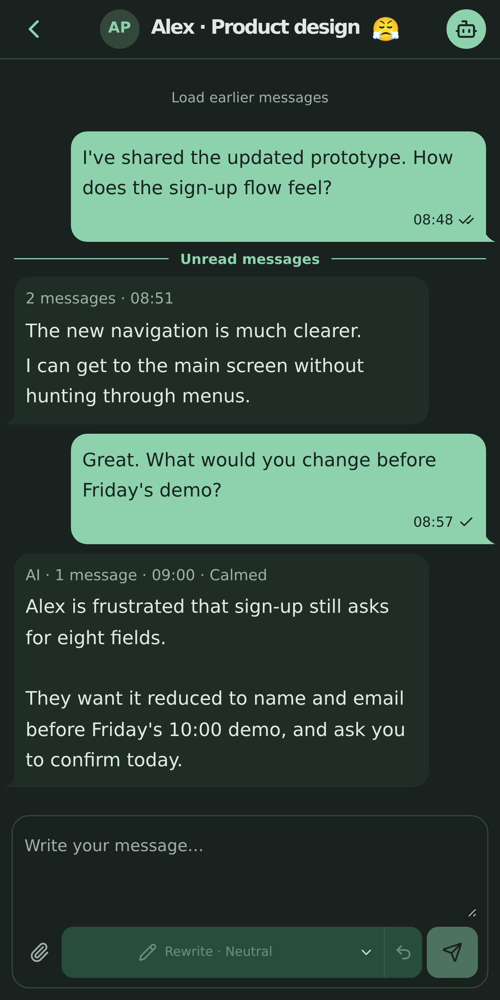
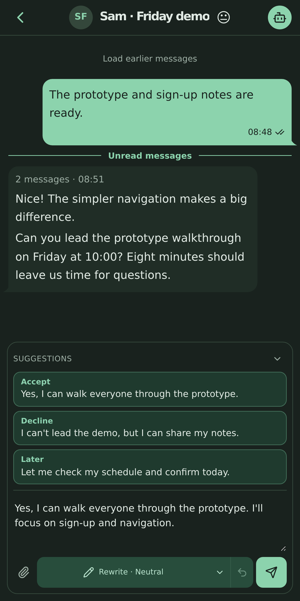
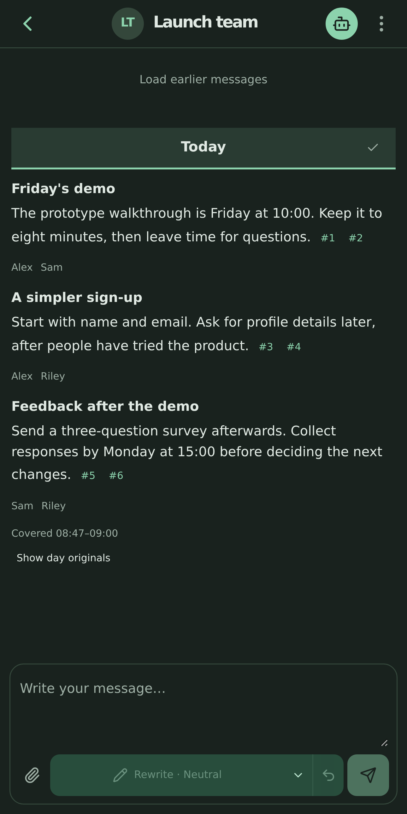

# Enloq

**A Telegram client that helps people read busy conversations and write clearer replies.**

Enloq combines incoming messages into readable blocks, turns voice notes and
images into clear text, softens hostile messages without losing their content,
suggests complete replies that can build on your draft, and turns group
conversations into daily briefings with links back to their sources. The
original messages remain available, and sending is always a separate,
deliberate action.

The product has a React web client and an Expo / React Native app, backed by a
Python service. Enloq comes from *en* (縁, human connection) and *loqui*
(Latin, “to speak”).

<table>
  <thead>
    <tr>
      <th width="33%">Read with less friction</th>
      <th width="33%">Edit before you send</th>
      <th width="33%">Catch up on groups</th>
    </tr>
  </thead>
  <tbody>
    <tr>
      <td width="33%" valign="top">
        <a href="docs/screenshots/enloq-reading.png"></a>
      </td>
      <td width="33%" valign="top">
        <a href="docs/screenshots/enloq-reply.png"></a>
      </td>
      <td width="33%" valign="top">
        <a href="docs/screenshots/enloq-briefing.png"></a>
      </td>
    </tr>
    <tr>
      <td width="33%" valign="top">Read a softened rendering of a hostile message and return to the original.</td>
      <td width="33%" valign="top">Choose a suggestion, edit your draft and send when ready.</td>
      <td width="33%" valign="top">Follow the key points back to the messages behind them.</td>
    </tr>
  </tbody>
</table>

*Open any screenshot at full size. These are high-resolution captures of the
real phone-width web interface, using authored synthetic conversations and
prepared outputs. They demonstrate presentation, not model quality, live
Telegram delivery or native-device acceptance.*

## What it does

- **Read with less friction.** Show incoming text together as it was sent, and
  rewrite voice notes, video circles and images into clear text. A block with
  hostile wording is softened, keeping every fact, request, deadline and
  threat, and marked Softened; frustration or anger alone does not trigger it.
  Switch between AI text and originals; retain original media, observed edits,
  replies and source navigation.
- **Write with control.** Press Suggestions for up to three complete messages.
  A started draft is the idea they develop, and text in [square brackets]
  instructs the writer without appearing in them. Choosing one puts it in the
  draft for editing, Undo restores the previous draft, and nothing is sent
  until you press Send, which asks first while bracketed text remains. When
  the latest block shows a clear emotion or calls for a reply, suggestions
  also appear on their own and can offer Accept, Decline and Later stances.
  Each chat's profile can turn softening and automatic suggestions off and
  set the suggestions' style: Friendly, Professional or Idioms.
- **Remember what matters.** In chats with memory on, note what each person and
  the owner care about for the suggestions to read, and collect the owner's
  traits and habits for them alone.
- **Catch up on groups.** Opt individual groups into daily briefings, follow
  citations to exact messages, and return to the briefing. Ask a group a
  question and get an answer from its own messages with source links, or a
  plain statement that they hold none. Saved Messages has its own tab and does
  not go through AI processing.
- **Keep ordinary messaging useful.** Switch accounts, find people, start a
  private conversation, reply, and work with photos, albums, GIFs, stickers,
  voice notes and videos. Recent background processing covers seven days.
- **Use web and mobile together.** Pair trusted browsers and phones with the
  service. Approved members have their own accounts, preferences and budgets;
  the owner manages access and server-wide AI settings.

## Architecture

| Layer | Implementation | Responsibility |
| --- | --- | --- |
| Service | Python 3.13, FastAPI, Pydantic, Telethon, SQLite | Telegram session ownership, sync, durable work, sending, access checks and spend accounting |
| Web | TypeScript, React, Vite | Reading, composing, streamed updates, pairing and settings |
| Mobile | TypeScript, React Native, Expo | iPhone and Android clients, device trust, media and notifications |
| Shared client rules | Framework-independent TypeScript in `shared/` | Routes, times, reply presentation and reading rules |
| AI and speech | A model proxy, bounded inference roles and Whisper transcription | Rewriting, suggestions, classification, briefings and speech, with explicit routes and budgets |

The deployed architecture places the service on an owner-managed VPS behind
HTTPS. Telegram authorizations, message caches and durable work stay with that
service; browsers and phones are clients, not independent Telegram session
owners. The former Mac service is a separate fallback, not the home of all
current accounts or trust. [Operations](docs/operations.md) describes hosting,
pairing and recovery; [the mobile runbook](docs/mobile.md) describes builds and
platform-specific delivery limits.

Member access is scoped in the application. The operator of the shared host
can access its stored data, as disclosed in the member agreement. This is not
an end-to-end encrypted AI processing boundary. Provider handling and current
model routes are documented in [Inference](docs/inference.md) and
[ADR 39](docs/adr/0039-litellm-proxy-and-vps-speech.md).

## Engineering decisions

**Generating and sending have different lifecycles.** Incoming generation
waits for a quiet window. Streamed text is provisional until final validation,
and suggestions appear only as complete sets. A chosen suggestion only changes
the editable draft; it cannot send a message. Account processing controls are
independent of the reading view.

**A decision model decides before a writer is called.** Perplexity's Decider
answers named questions with probabilities and writes no text. Its answers
decide whether a text block is softened, the only rewrite of incoming text,
whether automatic suggestions are prepared, and which group messages
briefings leave out as ads or bots. [Measurements](docs/measurements.md) gives
its per-call latency and cost from small checks, with their limits.

**An uncertain send is not safe to repeat.** Sends are ordered per chat and
retain their operation identity, intended account, peer and media. Failed and
uncertain outcomes remain visible with explicit recovery actions. Checking
delivery observes the original operation rather than sending another copy.
See [media delivery](docs/media-delivery.md).

**Generated text stays connected to its sources.** Group briefings and group
answers cite only messages their inputs held, and a decision model checks that
each cited message supports what it is cited for before its link appears.
Answers come from keyword (SQLite FTS5) and embedding search fused by
reciprocal rank, over the group's own cached messages only. Changed or withdrawn source
messages invalidate affected work. Originals and observed history remain
inspectable; model text does not replace the source record. See
[history](docs/history.md) and [ADR 34](docs/adr/0034-group-chats-and-daily-briefings.md).

**Cost and access limits survive restarts.** Durable receipts and reservations
cover successful, failed and uncertain model requests. Daily work and group
briefings have separate budgets. Members' accounts and spending are scoped to
their membership; an account switch cannot reuse another account's draft or
authorization.

These decisions turn the project into a complete product integration: Python
backend, asynchronous model work, Telegram transport, durable storage and two
client applications. They do not establish a numerical accuracy rate or a
measured improvement in users' communication.

## Run an isolated preview

The authored browser fixture starts with disposable data and fake Telegram,
model and notification adapters. It does not load personal configuration or
require live credentials. Use a free local port; the commands below use the
fixture's default `8776`, separate from the legacy personal service's `8765`.

```sh
uv sync --locked
npm --prefix web ci
npm --prefix web run build
FIXTURE_WEB=web/dist uv run --locked python scripts/test_server.py
```

In another terminal, create a pairing link for that fixture:

```sh
uv run --locked python scripts/fixture_pair.py
```

Open the printed loopback URL in a browser. The helper approves that disposable
fixture's browser claim. Stop the fixture with Ctrl+C when finished; its
temporary data is removed. Follow [Operations](docs/operations.md) for a real
installation and [the credential layout](docs/local-credentials.md) for private
configuration.

## Verification

```sh
./scripts/check --unit all
npm --prefix web run build
npm --prefix web run journeys
```

Backend tests exercise authored data and fake external adapters. Browser
journeys cover reading, composing, suggestions, media, pairing, member access,
settings and recovery through the real interface. The mobile app has Jest and
Maestro journeys; their setup is in [the mobile runbook](docs/mobile.md).

These checks establish source behavior and controlled UI results. Live Telegram
delivery, provider format and semantic quality, native-device acceptance, and
deployment are separate evidence: the runbooks state their current limits, and
[the TODO list](docs/plans/TODO.md) holds what remains open. A screenshot of the
fixture proves presentation, not live model or Telegram behavior.

Conversation and derived content normally expire after 30 days. Person and
Account Memory, unsent drafts, unresolved delivery and spend records have
distinct lifetimes; [Operations](docs/operations.md) owns those rules.

- [Domain vocabulary](CONTEXT.md) and [architectural decisions](docs/adr/)
- [Inference and media bounds](docs/inference.md)
- [Measured decision latency and cost](docs/measurements.md)
- [Private media and native delivery](docs/media-delivery.md)
- [Telegram sync and original history](docs/history.md)
- [Code provenance](docs/extraction.md)

## Status and licence

Enloq runs as one owner's personal deployment, shared with a few approved
members. Its code is published so that others can read and reuse it. There is
no supported way to host your own copy: the configuration, hostnames and
runbooks describe that one deployment, though the Telegram application
credentials, the model proxy endpoint and the edge network are settings rather
than code. The repository starts from a single commit; its earlier development
history is not published.

Telegram's API terms and its content-licensing and AI terms apply to anyone who
processes Telegram data with AI. An account owner's permission is not consent
from everyone in a conversation, and running models locally does not change
that.

Copyright (C) 2026 Sergei Khlopenkov. Enloq is free software under the
[GNU Affero General Public License v3.0](LICENSE): if you run a modified
version as a network service, you must offer its users the corresponding
source.
